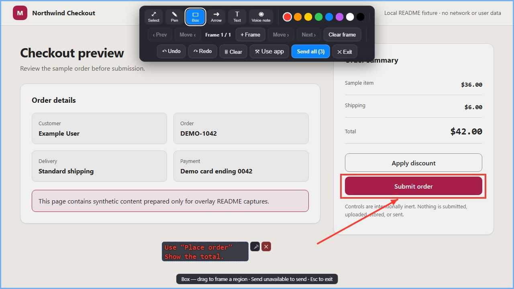

# Marshal Overlay Review

`@marshal/overlay-review` adds **Review on screen** to Marshal. It opens an
always-on-top Electron overlay for drawings, text notes, voice pins, clean
screenshots, and multi-frame visual feedback.



_Actual Overlay renderer over synthetic checkout data. This browser-only demo
did not exercise native desktop capture, sending, or voice recording._

When enabled as a Runtime extension, it contributes:

- capability `overlay.review.launch`;
- application `overlay-review`; and
- an `augment` action at `marshal.chat.composer.add`.

It does not add MCP tools or run as a standalone application.

## Requirements

- Node.js 22.13 or newer
- pnpm 10.32.1
- Electron 22 or newer in the host
- Runtime service `@marshal/marshal:ui.review@1.0.0`

The host service activates the package UI and launches a review for the active
session. `overlay.review.launch` requires `sessionId` to match the active
invocation session scope and accepts an optional nonempty `sessionTitle`. A
missing service prevents extension activation.

## Build and install

For a Marshal Runtime source checkout, place this repository at:

```text
<marshal-agent-runtime>\extensions\<repository>
```

Then build it:

```powershell
pnpm install
pnpm verify
```

`pnpm verify` runs tests, type checking, and a clean build. The Runtime
entrypoint is `dist\extension\runtime.cjs`.

Open **Marshal > Plugins**, refresh the Runtime catalog, find
`@marshal/overlay-review`, then explicitly **Install** and **Enable** it.
Filesystem discovery only publishes a catalog candidate; it does not install,
enable, activate, or execute the extension.

Packaged Marshal installations use the extension location managed by the
Plugins host rather than the source-checkout directory above.

## Use

1. Open a Marshal session.
2. Open the composer **+** menu and select **Review on screen**.
3. Draw, add a text note, or add a voice pin.
4. Use **+ Frame** for another screen state, or **Use app** to interact with the
   application underneath.
5. Select **Send all** to deliver the review to the active session.

At least one nonempty drawing, text annotation, or voice pin is required. The
overlay hides before capture so its own controls are not included.

## Configuration

The Runtime extension has no configuration schema. Direct Electron embedders
can call `createOverlay()` and configure these options:

| Option | Default |
| --- | --- |
| `toggleShortcut` | `CommandOrControl+Shift+Space` |
| `submitShortcut` | `CommandOrControl+Enter` |
| `passthroughShortcut` | `CommandOrControl+Shift+S` |
| `clearOnSubmit` | `true` |
| `screenshotDelayMs` | `120` |
| `includeComposite` | `true` |
| `defaultColor` | `#ff3b30` |
| `defaultStrokeWidth` | `4` |

The direct API also accepts tint and color settings, host metadata, screenshot
and transcription hooks, destination listing, error handling, and submission
delivery. `show()` accepts the target `sessionId` and optional `sessionTitle`.

## Current limitations

- Capture is full-display only; there is no video, region, or window selector.
- Voice recording requires microphone permission; transcription requires a host
  hook.
- Display matching can be approximate where Electron does not expose
  `display_id`.
- Global shortcuts can conflict with other applications and can be disabled by
  direct embedders.
- ASAR packaging must leave `dist\renderer` and `dist\main\preload.cjs`
  unpacked.

## License

[MIT](LICENSE)
